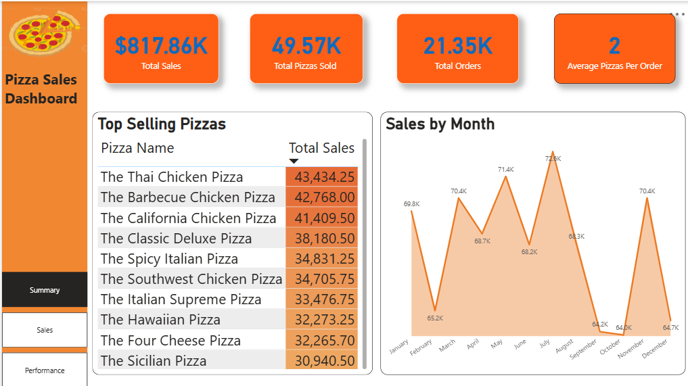
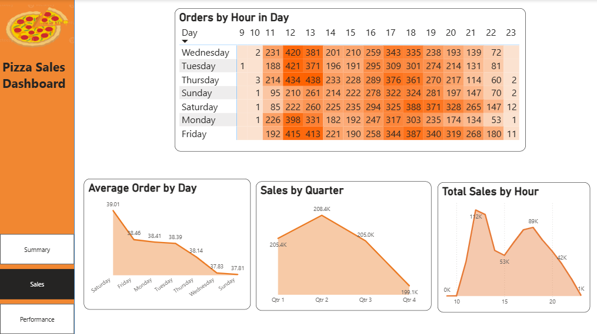
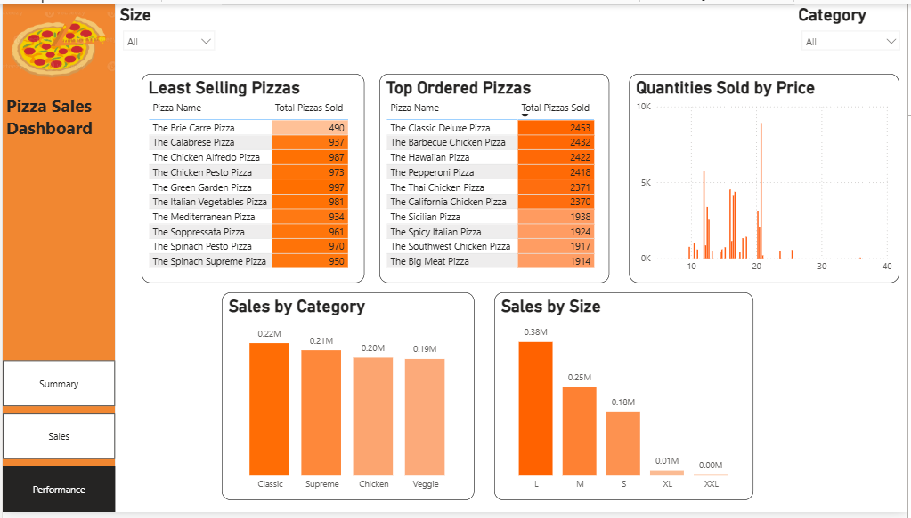

# Pizza Sales Analysis

An interactive Power BI dashboard that looks at one year of pizza restaurant sales to show where revenue comes from, which pizzas carry the menu, and when the kitchen is busiest.

## Project Overview and Business Problems

The goal is to give stakeholders a clear view of revenue and product performance so they can improve sales, tighten the menu, and plan operations around real demand.

The dashboard answers six questions:

- When are the busiest hours and days?
- Which pizzas generate the most revenue?
- Which pizzas should potentially be removed?
- What pizza sizes are most popular?
- How much does each customer spend per order?
- Do customers tend to buy multiple pizzas?

Those answers support four business outcomes: stronger revenue, a clearer picture of demand, a more efficient menu, and a better operational plan.

## Data Sources and Transformations

The source data is the [Pizza Place Sales](https://www.mavenanalytics.io/data-playground) sample dataset from Maven Analytics. It covers a fictional pizza restaurant and is stored in `pizza_sales/` as four tables:

| Table | Grain | Key columns |
| --- | --- | --- |
| `orders` | One row per order | `order_id`, `date`, `time` |
| `order_details` | One row per pizza on an order | `order_details_id`, `order_id`, `pizza_id`, `quantity` |
| `pizzas` | One row per pizza and size | `pizza_id`, `pizza_type_id`, `size`, `price` |
| `pizza_types` | One row per pizza recipe | `pizza_type_id`, `name`, `category`, `ingredients` |

Transformations in Power Query:

- Promoted the first row of `pizza_types` to the header.
- Created an hour column from `orders[time]`.
- Created day name and day number columns from `orders[date]`.

The dataset is clean: no missing rows, and the type changes loaded without errors.

## Data Model and DAX

The model is a snowflake. `order_details` joins to `orders` on `order_id` and to `pizzas` on `pizza_id`. `pizzas` joins to `pizza_types` on `pizza_type_id`. The hierarchy keeps each fact in one place and avoids repeating pizza names, categories, and prices on every order line.


Core measures:

```dax
Total Revenue =
SUMX(
    order_details,
    order_details[quantity] * RELATED(pizzas[price])
)

Total Orders = DISTINCTCOUNT(orders[order_id])

Total Pizzas Sold = SUM(order_details[quantity])

Average Order Value = DIVIDE([Total Revenue], [Total Orders])

Average Pizzas per Order = DIVIDE([Total Pizzas Sold], [Total Orders])
```

A rank measure flags the bottom 10 pizzas by setting `Bottom 10 Pizza` to 1 when a pizza’s rank falls in the last 10 names in `pizza_types`.

## Visuals and Key Insights

Open `Dashboard.pbix` in Power BI Desktop to use the report. The pages below are the published views.

### Summary



The restaurant took **21.35K orders**, sold **49.57K pizzas**, and generated **$817.86K** in revenue. Customers order about **2 pizzas** per order.

Revenue is concentrated in a short list of pizzas. The Thai Chicken Pizza leads at **$43,434**, followed by the Barbecue Chicken Pizza at **$42,768** and the California Chicken Pizza at **$41,410**. The rest of the top 10 still sits between about **$30,000** and **$38,000**.

Monthly sales move between roughly **$64K** and **$73K**. March through August is the stronger stretch, with July the peak month at **$72.8K**. October and November are the weakest months, at **$64.2K** and **$64.0K**.

### Sales



Orders build from late morning, peak at lunch (**12–1 PM**), and peak again in the early evening (**5–7 PM**). The busiest window across the week is **12 PM to 6 PM**. Early morning and late evening are the quietest hours. Total sales by hour follows the same shape: about **$112K** around the lunch peak, a drop to about **$53K** in the mid-afternoon, and a second peak near **$89K** in the evening. The pattern is steady through the week, with slightly stronger peaks toward the weekend.

Quarterly revenue rises from **$205.4K** in Q1 to **$208.4K** in Q2, eases to **$205.0K** in Q3, then drops to **$199.1K** in Q4. That matches the stronger March-to-August months, most of which fall in Q2, and the weaker close to the year.

Average order value stays in a narrow band. Saturday is highest at **$39.01**. Friday through Tuesday stays around **$38.14–$38.46**. Wednesday (**$37.83**) and Sunday (**$37.81**) are the lowest. Spending is a little stronger at the start of the weekend and softer toward the middle and end of the week.

### Performance



The Classic Deluxe Pizza is the most ordered item at **2,453** pizzas, followed by the Barbecue Chicken Pizza (**2,432**) and the Hawaiian Pizza (**2,422**). The Brie Carre Pizza is the clear outlier at the bottom, with only **490** sold. Every other pizza in the least-sold list still sells between about **930** and **1,000**.

That gap is large enough to act on. Stock more of the ingredients behind Classic Deluxe and Barbecue Chicken, and review whether Brie Carre should stay on the menu.

Most quantity sold sits between **$10** and **$20**, with spikes near **$12**, **$15**, and a sharp peak around **$20**. Items under **$10** and over **$20** sell in much smaller quantities.

By category, Classic leads at about **$0.22M**, then Supreme (**$0.21M**), Chicken (**$0.20M**), and Veggie (**$0.19M**). By size, Large generates **$0.38M**, Medium **$0.25M**, and Small **$0.18M**. XL and XXL together contribute well under **$10K**. The menu should stay focused on L and M, and XL and XXL are candidates to drop.

## Interactive Features

- A page navigator moves between Summary, Sales, and Performance.
- On the Performance page, Size and Category slicers filter the tables and charts so a stakeholder can inspect one size or one category at a time.

## Repository

```text
Dashboard.pbix          Power BI report
pizza_sales/            Source CSV files
img/                    Dashboard and data model screenshots
report/Report.pdf       Written analysis
```
